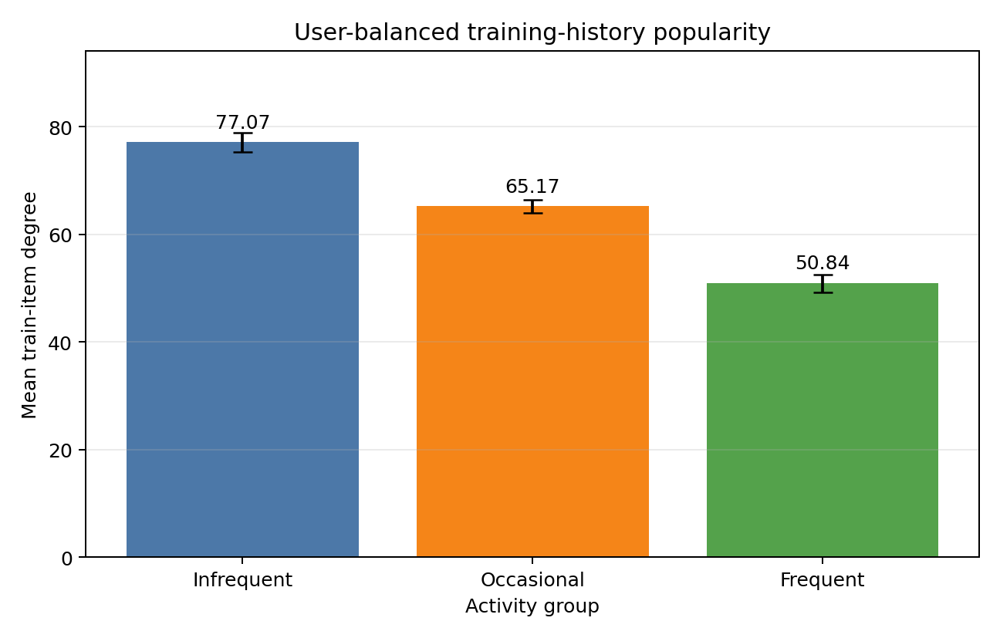
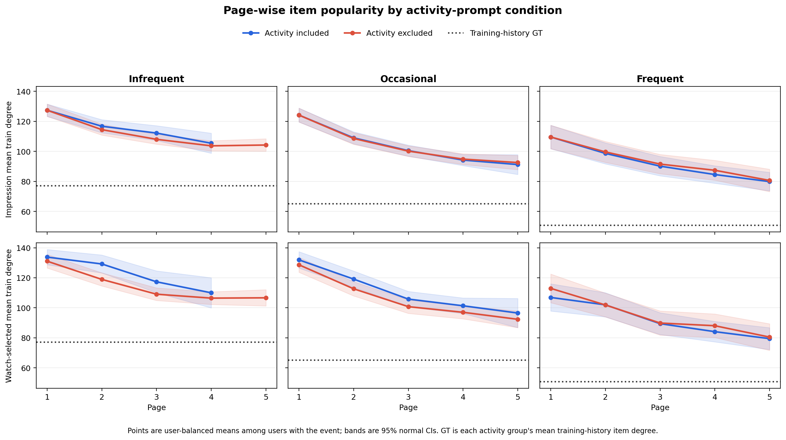

# Popularity Bias by Activity Group

Generated by `scripts/analyze_activity_degree_gt.py` at `2026-11-22T07:20:30+00:00`.

## Scope and definitions

- Dataset: `ml-1m`; users: 1,000.
- Activity groups are the repository-provided groups derived from each user's full MovieLens rating count: group 1 below the global 60th percentile, group 2 from the 60th to below the 90th percentile, and group 3 at or above the 90th percentile.
- Item degree is the number of distinct users interacting with that item in `cf_data/train.txt`. Validation and test interactions are excluded from the degree calculation.
- Primary GT is **user-balanced**: calculate each user's mean degree across their training items, then summarize those user means within each activity group.
- This report is descriptive. Group differences already present in training history are not evidence that the injected persona caused bias.

## Activity group composition

| Activity group | Users | Train interactions | Min full-history count | Max full-history count | Mean full-history count |
| --- | --- | --- | --- | --- | --- |
| 1 (Infrequent) | 539 | 14550 | 22 | 125 | 67.4842 |
| 2 (Occasional) | 352 | 31822 | 126 | 399 | 225.9659 |
| 3 (Frequent) | 109 | 27899 | 403 | 1595 | 639.8716 |

## Primary GT: distribution of per-user mean train-item degree

| Activity group | Users | Mean | SD | Mean 95% CI | Min | P10 | P25 | Median | P75 | P90 | Max |
| --- | --- | --- | --- | --- | --- | --- | --- | --- | --- | --- | --- |
| 1 (Infrequent) | 539 | 77.0660 | 20.7635 | 75.3131–78.8189 | 17.6923 | 51.5258 | 63.2700 | 75.4839 | 89.4353 | 105.0804 | 137.3333 |
| 2 (Occasional) | 352 | 65.1706 | 11.6268 | 63.9559–66.3852 | 29.9074 | 50.2435 | 58.0029 | 65.3604 | 73.1289 | 79.8200 | 95.9804 |
| 3 (Frequent) | 109 | 50.8405 | 8.8471 | 49.1796–52.5014 | 25.7459 | 41.5419 | 45.2678 | 50.3818 | 57.1598 | 62.5147 | 70.4235 |

Bars show group means; error bars show 95% confidence intervals across users.

Frequent minus infrequent mean degree: `-26.2255`. Frequent/infrequent ratio: `0.6597`. Spearman correlation between the original activity count and each user's mean train-item degree: `-0.4769`.

## Interpretation boundary

This GT answers whether activity groups already consumed differently popular items in the training data. To test whether **injecting** the activity persona creates or amplifies popularity bias, compare otherwise identical simulations with the activity prompt enabled versus removed or shuffled, and measure the change relative to this group-specific GT.

<!-- MANUAL_APPENDIX_START -->
## Experiment comparison registry

Append future simulation settings here without modifying the GT section above.

| Setting | Activity prompt | Selection event | Users | Degree definition | Result artifact | Status |
| --- | --- | --- | ---: | --- | --- | --- |
| GT: training history | N/A | Train interaction | 1,000 | Train user degree | This report | Complete |
| LightGCN + Luna | Included | recommended/align/watch/like | 1,000 | Train user degree | `agent4rec_lightgcn_luna_1000_5pages_batch4_from200` | Complete; 200 seeded results plus 800 resumed users, final resume job `14372873` |
| LightGCN + Luna | Excluded | recommended/align/watch/like | 1,000 | Train user degree | `agent4rec_lightgcn_luna_1000_5pages_no_activity` | Complete |

## Planned simulation comparisons

For each setting, report `recommended_id`, `align_id`, `watch_id`, and `like_id` separately. Compare the user-balanced selected-item mean degree with this GT using both an absolute delta and a ratio. A causal claim about persona injection requires an otherwise identical run with the activity description removed or shuffled.

<!-- SIMULATION_COMPARISON_START -->
## Simulation comparison: activity persona included vs excluded

- Included run: `/home1/moonsoo/projects/ara/click_conversion_reranker/base/Agent4Rec/storage/ml-1m/LightGCN/agent4rec_lightgcn_luna_1000_5pages_batch4_from200`
- Excluded run: `/home1/moonsoo/projects/ara/click_conversion_reranker/base/Agent4Rec/storage/ml-1m/LightGCN/agent4rec_lightgcn_luna_1000_5pages_no_activity`
- Cached ranking arrays byte-identical: `True`
- `Selected − GT` is calculated per user before taking the group mean. Positive values indicate selection of higher-degree items than that user's own training-history baseline.
- `Selected − impression` is also calculated per user. It separates selection from the popularity level already present in the displayed recommendation pages.
- Unresolved title matches are excluded from the corresponding selected-event ID list; raw responses remain available for post-hoc repair.

### Group-specific results

| Mode | Event | Activity group | Users with event | Coverage (%) | Selected mean degree | Group GT mean | Mean individual (selected−GT) | Mean individual (selected−impression) |
| --- | --- | --- | --- | --- | --- | --- | --- | --- |
| included | recommended | 1 (Infrequent) | 539 | 100.0000 | 120.3828 | 77.0660 | 43.3168 | 0.0000 |
| included | recommended | 2 (Occasional) | 352 | 100.0000 | 107.3895 | 65.1706 | 42.2189 | 0.0000 |
| included | recommended | 3 (Frequent) | 109 | 100.0000 | 93.1617 | 50.8405 | 42.3212 | 0.0000 |
| included | align | 1 (Infrequent) | 538 | 99.8145 | 120.4301 | 77.0660 | 43.4355 | 0.1433 |
| included | align | 2 (Occasional) | 352 | 100.0000 | 107.5423 | 65.1706 | 42.3717 | 0.1528 |
| included | align | 3 (Frequent) | 109 | 100.0000 | 93.4518 | 50.8405 | 42.6113 | 0.2901 |
| included | watch | 1 (Infrequent) | 480 | 89.0538 | 128.1351 | 77.0660 | 51.0206 | 7.5078 |
| included | watch | 2 (Occasional) | 333 | 94.6023 | 114.4036 | 65.1706 | 49.1849 | 7.8680 |
| included | watch | 3 (Frequent) | 108 | 99.0826 | 93.7147 | 50.8405 | 42.9689 | 1.0042 |
| included | like | 1 (Infrequent) | 323 | 59.9258 | 140.9247 | 77.0660 | 61.4767 | 12.9093 |
| included | like | 2 (Occasional) | 272 | 77.2727 | 136.2035 | 65.1706 | 69.8497 | 26.5931 |
| included | like | 3 (Frequent) | 96 | 88.0734 | 115.8191 | 50.8405 | 64.6688 | 20.8945 |
| excluded | recommended | 1 (Infrequent) | 539 | 100.0000 | 112.5867 | 77.0660 | 35.5207 | 0.0000 |
| excluded | recommended | 2 (Occasional) | 352 | 100.0000 | 105.1857 | 65.1706 | 40.0151 | 0.0000 |
| excluded | recommended | 3 (Frequent) | 109 | 100.0000 | 94.6033 | 50.8405 | 43.7628 | 0.0000 |
| excluded | align | 1 (Infrequent) | 539 | 100.0000 | 112.1782 | 77.0660 | 35.1122 | -0.4085 |
| excluded | align | 2 (Occasional) | 352 | 100.0000 | 105.3791 | 65.1706 | 40.2086 | 0.1935 |
| excluded | align | 3 (Frequent) | 109 | 100.0000 | 94.6654 | 50.8405 | 43.8249 | 0.0621 |
| excluded | watch | 1 (Infrequent) | 531 | 98.5158 | 115.8071 | 77.0660 | 38.8209 | 3.4592 |
| excluded | watch | 2 (Occasional) | 346 | 98.2955 | 109.9195 | 65.1706 | 44.6621 | 4.3508 |
| excluded | watch | 3 (Frequent) | 108 | 99.0826 | 97.7510 | 50.8405 | 46.8558 | 2.8944 |
| excluded | like | 1 (Infrequent) | 492 | 91.2801 | 130.6024 | 77.0660 | 52.8518 | 16.3144 |
| excluded | like | 2 (Occasional) | 315 | 89.4886 | 129.4071 | 65.1706 | 63.5414 | 21.4594 |
| excluded | like | 3 (Frequent) | 96 | 88.0734 | 121.1261 | 50.8405 | 69.7604 | 23.9462 |

### Activity-prompt effect

`Included − excluded` isolates the prompt condition. The paired column uses only users with the event in both runs.

| Event | Activity group | Included mean | Excluded mean | Unpaired difference | Paired users | Paired mean difference |
| --- | --- | --- | --- | --- | --- | --- |
| recommended | 1 (Infrequent) | 120.3828 | 112.5867 | 7.7961 | 539 | 7.7961 |
| recommended | 2 (Occasional) | 107.3895 | 105.1857 | 2.2038 | 352 | 2.2038 |
| recommended | 3 (Frequent) | 93.1617 | 94.6033 | -1.4416 | 109 | -1.4416 |
| align | 1 (Infrequent) | 120.4301 | 112.1782 | 8.2519 | 538 | 8.3259 |
| align | 2 (Occasional) | 107.5423 | 105.3791 | 2.1631 | 352 | 2.1631 |
| align | 3 (Frequent) | 93.4518 | 94.6654 | -1.2136 | 109 | -1.2136 |
| watch | 1 (Infrequent) | 128.1351 | 115.8071 | 12.3279 | 473 | 11.1665 |
| watch | 2 (Occasional) | 114.4036 | 109.9195 | 4.4841 | 329 | 4.9521 |
| watch | 3 (Frequent) | 93.7147 | 97.7510 | -4.0364 | 107 | -3.5755 |
| like | 1 (Infrequent) | 140.9247 | 130.6024 | 10.3222 | 312 | 5.5410 |
| like | 2 (Occasional) | 136.2035 | 129.4071 | 6.7964 | 263 | 6.8786 |
| like | 3 (Frequent) | 115.8191 | 121.1261 | -5.3070 | 91 | -2.3370 |

<!-- SIMULATION_COMPARISON_END -->

## Page-wise impression and selection degree

The page-wise figure separates the popularity of displayed impressions from the popularity of watch-selected items. Condition-specific lines use users who reached that page; consequently, later-page impression differences can reflect differential attrition even though the cached full rankings are identical.

Underlying summaries, including page reach and event coverage, are stored in `analysis/artifacts/pagewise_activity_degree_summary.csv`.

## Identical-exposure common-prefix analysis

For each user, the common prefix is defined as pages `1..min(included last page, excluded last page)`. The cached ranking and every page-level candidate sequence were checked before comparison: all **11,896 paired item impressions matched exactly**, with zero candidate mismatches. This isolates behavior on observed identical exposures, although the common-prefix length remains a post-treatment quantity affected by both conditions' exit decisions.

### Common-prefix coverage

The `L=1` through `L=5` columns are mutually exclusive counts of users whose common prefix ended at exactly that page.

| Activity group | Users | Included mean pages | Excluded mean pages | Mean common pages | Median | L=1 | L=2 | L=3 | L=4 | L=5 |
| --- | ---: | ---: | ---: | ---: | ---: | ---: | ---: | ---: | ---: | ---: |
| Infrequent | 539 | 2.278 | 4.150 | 2.256 | 2 | 182 | 134 | 126 | 97 | 0 |
| Occasional | 352 | 3.892 | 4.318 | 3.682 | 4 | 23 | 15 | 62 | 203 | 49 |
| Frequent | 109 | 4.761 | 4.330 | 4.239 | 4 | 3 | 0 | 16 | 39 | 51 |

### Watch behavior on identical impressions

All differences are activity-included minus activity-excluded. Selection-rate tests include every user. Selected-degree tests include users with at least one resolved watch in both conditions, so they measure the composition of nonempty selected sets rather than the unconditional population effect. `q` is Benjamini-Hochberg adjusted within each metric's nine activity-by-event comparisons.

| Activity group | Included watch rate | Excluded watch rate | Rate difference | Included selected degree | Excluded selected degree | Degree difference (95% CI) | Degree p | Degree q |
| --- | ---: | ---: | ---: | ---: | ---: | ---: | ---: | ---: |
| Infrequent | 0.2063 | 0.5580 | -0.3517 | 127.553 | 124.235 | +3.318 [0.814, 5.821] | 0.00951 | 0.0285 |
| Occasional | 0.3683 | 0.6276 | -0.2592 | 115.633 | 111.940 | +3.693 [1.844, 5.543] | 0.000105 | 0.000941 |
| Frequent | 0.7410 | 0.7003 | +0.0407 | 95.543 | 97.494 | -1.950 [-3.882, -0.018] | 0.0479 | 0.108 |

The activity prompt therefore has a large and robust **selection-volume** effect: it sharply suppresses watches for Infrequent and Occasional agents, while the Frequent difference is smaller and not significant. Conditional on watching in both runs, included Infrequent and Occasional agents choose higher-degree subsets. The Frequent direction is lower degree, but it does not remain significant after correction across the nine activity-by-event comparisons.

Detailed artifacts are stored in:

- `analysis/artifacts/common_prefix_reach_summary.csv`
- `analysis/artifacts/common_prefix_paired_summary.csv`
- `analysis/artifacts/common_prefix_user_metrics.csv`
- `analysis/artifacts/common_prefix_item_pairs.csv`
